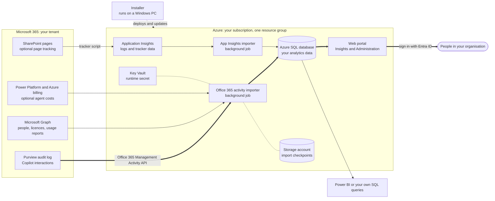

# Microsoft 365 Advanced Analytics

**Copilot and Microsoft 365 analytics that you own.**

Microsoft 365 Advanced Analytics is a free, open-source solution that you deploy into your own Azure subscription. It continuously collects Microsoft 365 usage data, above all **Microsoft 365 Copilot**, into an **Azure SQL database you own**, and puts a **web portal** on top of it:

- **Insights**, for adoption and business owners: Copilot Adoption (who should keep a Copilot licence, and who should get one), Copilot investment and spend, agent costs, licence activity, and activity and adoption reports for Teams, SharePoint, OneDrive, Outlook and the other workloads you import.
- **Administration**, for the IT team that runs it: service health, connections, user scope and report settings.

People sign in with their work account, and Entra ID app roles decide who sees the Administration area and named individuals. **Power BI templates** and your own SQL queries work on the same database.

**Who it's for:** organisations that want to base Copilot licence and adoption decisions on evidence, see how Copilot and agents are really used, and keep Microsoft 365 usage history for longer than the admin centre does. Azure and Microsoft 365 administrators install and run it: you need to be comfortable administering both, but you don't need to know anything about this solution.

> **New here?** Start with **[Getting started](https://github.com/pnp/Microsoft365-Analytics-Insights/wiki/Getting%20Started)**, a step-by-step path from nothing to your first Copilot report.

Microsoft 365 already ships usage reports. This solution exists for everything those reports *don't* do: long-term history, raw queryable data, cross-workload correlation, and interaction, page, call and message-level detail, all joined to your own organisation structure.

## Why it's more than the built-in reports

| | Microsoft 365 built-in reports | Microsoft 365 Advanced Analytics |
|-|-|-|
| **History** | Rolling 7–180 days | Keep as long as you want — *you* control retention |
| **Data access** | Locked in the admin center, limited export | One SQL database in **your** Azure subscription — query it any way |
| **Scope** | Siloed per workload, pre-aggregated | Unified, joinable schema across every workload |
| **Granularity** | High-level counts | Page hits/clicks/sessions, per-call quality, per-email + sentiment, Copilot interactions, files & resources |
| **People** | Names often de-identified | Identifiable users enriched with department, manager, job title, office and license/SKU |
| **Reporting** | Microsoft's fixed report set | A web portal built for licence and adoption decisions, plus Power BI templates and your own reports |
| **Enrichment** | — | Optional AI sentiment, language & keyword detection |

## What you can do with it

- **Right-size Copilot licences** — see who holds a licence without really using it, and who uses Copilot Chat or Microsoft 365 heavily enough to benefit from one.
- **See how Copilot is really used** — in which apps, with which agents, against which files and resources, and whether use is becoming a habit.
- **Understand Copilot costs** — billed Copilot Studio credits per agent, and who is consuming credits.
- **Measure real adoption** by department, region, role or license — not just tenant-wide totals.
- **See how SharePoint is actually used** — page hits, sessions, link clicks, searches, render performance, geography and device, right down to the page.
- **Watch Teams call quality** and meeting habits at the session level.
- **Trend over years**, not weeks, with history you keep.

## What data is collected

Enable only the areas you need — permissions scale accordingly. Fully enabled, the engine collects:

- **SharePoint Online** — web traffic (page hits, clicks, sessions, performance, geo/device), file activity, searches, page metadata, comments & likes (with sentiment).
- **SharePoint & OneDrive usage** — per-user daily activity; per-site weekly activity & storage.
- **Teams & Calls** — teams, channels and membership; per-user activity; call & meeting detail with quality/feedback.
- **Outlook** — usage activity; optional per-recipient sent-email records with sentiment.
- **Viva Engage (Yammer), M365 Apps & platforms** — adoption and activity signals.
- **Copilot** — interactions, files, meetings, accessed resources (with sensitivity labels), models used.
- **Power Platform** — Power Apps / Automate / BI and Copilot Studio adoption events.
- **Users** — profile attributes (department, manager, title, office) and assigned SKUs.

> Full data-collection map: **[What data is collected](https://github.com/pnp/Microsoft365-Analytics-Insights/wiki/Data%20Collection)**.

## Getting started

All documentation lives in the **[wiki](https://github.com/pnp/Microsoft365-Analytics-Insights/wiki)**. New to the solution? Start with these two pages:

- **[Getting started](https://github.com/pnp/Microsoft365-Analytics-Insights/wiki/Getting%20Started)** — a step-by-step path to your first Copilot report, including the short list of prerequisites a Copilot-focused deployment needs.
- **[How it works](https://github.com/pnp/Microsoft365-Analytics-Insights/wiki/How%20It%20Works)** — the moving parts in plain English, with a diagram of the current architecture.

In short, you need an Azure subscription with a resource group to deploy into, someone who can create Entra ID app registrations and grant admin consent for the read-only Microsoft 365 permissions, and a Windows 10 or 11 machine with the .NET Framework 4.8 runtime to run the installer.

The full detail, by step:

1. **[Prerequisites](https://github.com/pnp/Microsoft365-Analytics-Insights/wiki/Prerequisites)** — service principals, permissions (Graph/Microsoft 365 API + Azure RBAC), tenant/subscription setup, summarised by feature.
2. **[Install with the installer](https://github.com/pnp/Microsoft365-Analytics-Insights/wiki/Deployment%20Guidance)** — the standard deployment.
3. **[Verify the deployment](https://github.com/pnp/Microsoft365-Analytics-Insights/wiki/Verify)** — confirm the import jobs are running.

See also [Release notes](https://github.com/pnp/Microsoft365-Analytics-Insights/wiki/Release%20Notes) and [Known issues](https://github.com/pnp/Microsoft365-Analytics-Insights/wiki/Known%20Issues).

## Ways to use the data

- **[The web portal](https://github.com/pnp/Microsoft365-Analytics-Insights/wiki/Web%20Portal)** — the Insights and Administration areas described above, including the **[Copilot Adoption](https://github.com/pnp/Microsoft365-Analytics-Insights/wiki/Copilot%20Adoption%20User%20Guide)** licence review.
- **[Copilot analytics](https://github.com/pnp/Microsoft365-Analytics-Insights/wiki/Copilot)** — what the Copilot data contains, and its limits.
- **[Activity & Usage Analytics](https://github.com/pnp/Microsoft365-Analytics-Insights/wiki/Analytics)** — Power BI reporting over the dataset.
- **Your own SQL queries and reports** — every table is documented in the [database schema](https://github.com/pnp/Microsoft365-Analytics-Insights/wiki/Database%20Schema).

Some features need extra setup after install — see [Optional extras](https://github.com/pnp/Microsoft365-Analytics-Insights/wiki/Getting%20Started#optional-extras).

### Related projects in this repository

- **[Telemetry Service](https://github.com/pnp/Microsoft365-Analytics-Insights/wiki/Telemetry%20Service)** — the receiver and Entra-protected aggregate dashboard for the anonymous usage reports that deployments send by default (see [below](#anonymous-usage-reporting-on-by-default)). Uploads are signed, and the source is under [`src/TelemetryService/`](src/TelemetryService).

## Architecture & running costs

The same diagram as [How it works](https://github.com/pnp/Microsoft365-Analytics-Insights/wiki/How%20It%20Works#the-big-picture), which explains each part.

Everything runs in one resource group in your subscription: an App Service that hosts the web portal and the two background import WebJobs, Azure SQL, a storage account, Key Vault and Application Insights, plus, depending on the installer options you choose, an Automation account, Service Bus, Azure AI Language and Azure OpenAI. No cache service is needed: the little runtime state the importers keep (checkpoints, delta tokens, schedule stamps) lives in an Azure Table in the solution's own storage account. A medium environment (~20,000 users, 1 year of data) is roughly **€160-170/month**, dominated by the App Service plan and SQL database — *indicative only; verify current pricing for your region and scale*.

Full breakdown: **[Architecture & costs](https://github.com/pnp/Microsoft365-Analytics-Insights/wiki/Architecture%20and%20Costs)**.

## Anonymous usage reporting (on by default)

The Office 365 activity importer sends the project team an anonymous report about the deployment, at most once a day, so that we can see which builds and imports are in use and how large deployments get. The report contains:

- a random ID generated for the installation, which isn't derived from your tenant;
- the build number, and which imports are switched on;
- the name, row count and size of each table in the solution's database;
- a count of records scored by Azure AI Language;
- rounded or bucketed Copilot and licence adoption figures, with licences named only by Microsoft's published SKU part numbers. Figures that would describe too few people are withheld or rolled together.

It never contains tenant, user or content identifiers: no tenant ID, people's names, email addresses, departments, agent names, URLs, prompts or other text from your tenant.

**To turn it off**, untick **Allow anonymous usage reporting to help improve the product** in the installer's **Review & deploy** section, then deploy. The importer follows the configuration the installer last deployed, so unticking the box without deploying changes nothing. The [Telemetry service](https://github.com/pnp/Microsoft365-Analytics-Insights/wiki/Telemetry%20Service) page lists every field.

## Support and contributing

This is an open-source community project of the [Microsoft 365 & Power Platform Community (PnP)](https://pnp.github.io/), provided as-is under the [MIT licence](LICENSE).

- **Questions and bugs:** open a [GitHub issue](https://github.com/pnp/Microsoft365-Analytics-Insights/issues). This repository is public, so leave out tenant names, user names, GUIDs, URLs and unredacted logs.
- **Security vulnerabilities:** report them privately, as described in [SECURITY.md](SECURITY.md). Don't open a public issue.
- **Contributing:** see [CONTRIBUTING.md](CONTRIBUTING.md).
